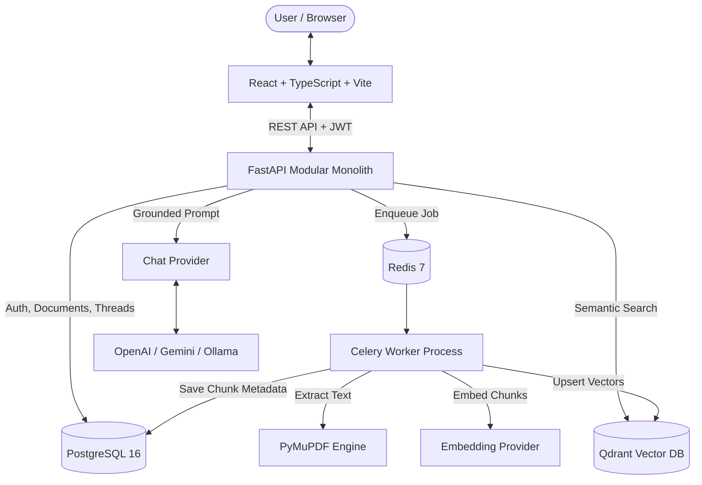

# KnowledgeAI: Architecture & System Design

## 1. Architectural Philosophy
KnowledgeAI is designed as a **modular monolith** adhering to clean architecture principles:
- **Thin Web Layer**: FastAPI controllers handle HTTP serialization, query parsing, status codes, and dependency injection.
- **Service Layer**: Pure business logic orchestrating extraction, chunking, AI providers, and vector indexing.
- **Repository Pattern**: Data access abstraction using SQLAlchemy 2.0 Async to ensure complete database independence.
- **Provider Adapters**: Framework- and vendor-independent abstractions for LLMs and embeddings (`ChatProvider`, `EmbeddingProvider`). Core services interact only with normalized domain types.
- **Asynchronous Task Processing**: High-latency extraction, chunking, embedding, and vector upserting occur in background Celery workers backed by Redis.

---

## 2. Component Breakdown

### 2.1 Backend Modules (`backend/app/`)
- `core/config.py`: Pydantic settings loading from `.env` with validation for providers, CORS, timeouts, and directories.
- `core/security.py`: Argon2id password hashing and signed HS256 JWT generation and validation.
- `core/logging.py`: Centralized logging with automated regex sanitization of API keys, passwords, and tokens.
- `core/exceptions.py`: Uniform application exceptions mapped directly to HTTP responses via FastAPI exception handlers.
- `db/base.py` & `db/session.py`: SQLAlchemy 2.0 async engine and session factory with connection pooling.
- `models/`: Explicit SQLAlchemy models:
  - `User`: Owner identity, password hash, status.
  - `Document`: File metadata, server storage key, SHA-256 checksum, ingestion status (`uploaded`, `processing`, `completed`, `failed`).
  - `DocumentChunk`: Text slices, page numbers, Qdrant vector IDs, metadata.
  - `Conversation`: Thread title, owner FK.
  - `Message`: Role (`user`, `assistant`), message text, serialized source citations, token usage.
- `ai/`:
  - `base.py`: Abstract definitions for `ChatProvider` and `EmbeddingProvider`.
  - `factory.py`: Instantiates active provider adapters based on environment configuration.
  - `providers/`: Adapters for OpenAI (`openai`), Google Gemini (`google-genai`), and local Ollama (`httpx`).
- `services/`:
  - `extraction_service.py`: Text and page extraction from PDF, TXT, and Markdown via PyMuPDF. Detects image-only/scanned PDFs without OCR text.
  - `chunking_service.py`: Recursive character splitting respecting paragraphs, sentences, and page numbers with configurable overlap.
  - `vector_service.py`: Qdrant client managing versioned collection names `{prefix}_{model}_{dimension}`, cosine distance, and owner-filtered search.
  - `rag_service.py`: Retrieval, prompt injection protection, grounded LLM query execution, and bracketed citation verification against real chunks.
  - `conversation_service.py`: Thread management, message persistence, and RAG execution.
- `workers/`:
  - `celery_app.py`: Celery initialization with Redis broker.
  - `document_tasks.py`: Idempotent async pipeline executing extraction, chunking, embedding generation, Qdrant upsert, and DB chunk record persistence.

---

## 3. Data Flow & RAG Ingestion Pipeline

### 3.1 Document Ingestion Flow
1. **Upload**: Client uploads file to `POST /api/v1/documents/upload`.
2. **Validation**: Check extension (`.pdf`, `.txt`, `.md`), MIME type, and size limit (25 MB).
3. **Deduplication**: Calculate SHA-256 hash. If duplicate exists for user, return `409 Conflict`.
4. **Storage**: Save file to `storage/<user_id>/<uuid>_<filename>`.
5. **Persistence**: Insert `Document` record in PostgreSQL with `status="uploaded"`.
6. **Task Dispatch**: Enqueue Celery task `process_document_task.delay(doc_id)`.
7. **Extraction & Chunking**: Celery worker extracts text and page numbers via PyMuPDF. Splits into ~800 character chunks with ~150 character overlap.
8. **Vector Embedding**: Active `EmbeddingProvider` batches chunk texts and generates vectors.
9. **Qdrant Upsert**: Points upserted to Qdrant collection with payload:
   `{owner_id, document_id, chunk_index, page_number, filename, content}`.
10. **Finalization**: `DocumentChunk` records inserted into PostgreSQL; `doc.status="completed"` and `doc.chunk_count` updated.

### 3.2 Grounded Retrieval & Answering Flow
1. **Chat Submission**: Client sends question to `POST /api/v1/chat`.
2. **Conversation Resolution**: If no conversation ID passed, create one automatically with a title derived from the query.
3. **Query Embedding**: Configured embedding provider embeds the query vector.
4. **Vector Search**: Search Qdrant enforcing `owner_id == current_user.id` filter (and optional document filters).
5. **Score Threshold**: Retain chunks passing similarity threshold ($\ge 0.60$). If no chunks pass, immediately return safe insufficient evidence message without querying LLM.
6. **Context Construction**: Format retrieved chunks with clear metadata boundaries `--- [Chunk <idx>] File: <name>, Page 
 ---`.
7. **Prompt Protection**: Inject system instructions treating retrieved context as untrusted data, commanding the model to answer strictly from evidence and cite chunks as `[Chunk <index>]`.
8. **Citation Verification**: Extract bracketed citations from model response; match with retrieved chunk objects. Reject any hallucinated IDs.
9. **Persistence**: Save user message and assistant message (with verified citations) to database.
10. **Response**: Return answer, citations list, and metadata to client.

